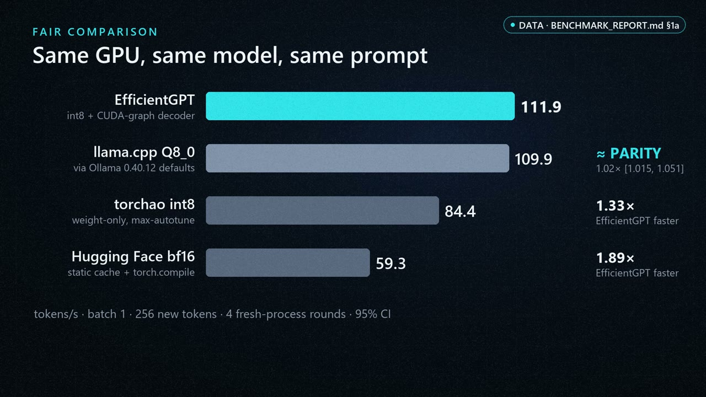

# EfficientGPT

**Batch-1 LLM decoding in plain PyTorch + Triton that matches llama.cpp on a consumer GPU, with every number backed by raw
evidence.** It combines a weight-only int8 Triton GEMV with a sync-free CUDA-graph decoder for Hugging Face models. On
Qwen3-1.7B, an RTX 4060 (8 GB) decodes at **111.9 tok/s**:
- at parity with llama.cpp Q8_0 (1.02×, 95% CI [1.015, 1.051], below the 5% bar this project uses to claim a win);
- **1.33×** torchao int8;
- **1.89×** Hugging Face bf16 with a compiled static cache.

The repository also contains **KernelAgent-Ada**, a template-based Triton kernel search built around verification. It
checks candidates against fp64 ground truth, mutation-tests its own evaluator, keeps held-out shapes aside and confirms
results end to end. That end-to-end check is what showed its 1.1–1.6× attention-kernel win was worth only about 1% of the
whole decode step.

Fork of [karpathy/nanoGPT](https://github.com/karpathy/nanoGPT). MIT licence.

## Watch the EfficientGPT Demo

[](https://youtu.be/SKWrki4NHn4)

🎬 **[Watch the EfficientGPT Showcase on YouTube](https://youtu.be/SKWrki4NHn4)**

See EfficientGPT's Qwen3-1.7B inference, CUDA Graph decoding, custom Triton kernels, and KernelAgent-Ada verification workflow.

**Measured performance:** 111.9 tokens/sec on an NVIDIA RTX 4060 (benchmark median of 4 fresh-process rounds) —
approximately at parity with the tested llama.cpp Q8_0 configuration. The single demo run recorded in the video shows
108.5 tokens/sec; that is one run, not the benchmark, and the 111.9 figure is the one compared in the table below.

The video illustrates the project; reproducible benchmark evidence, source code, and limitations are documented below
(figure sources for the video: [`docs/VIDEO.md`](docs/VIDEO.md)).

| Qwen3-1.7B, batch 1, greedy, 256 new tokens | tok/s | EfficientGPT vs it [95% CI] | TTFT | GPU memory |
|---|---|---|---|---|
| **EfficientGPT (int8 + CUDA-graph decoder)** | **111.9** | — | 54 ms | 2474 MiB |
| llama.cpp Q8_0 (via Ollama 0.40.12 defaults) | 109.9 | 1.02 [1.015, 1.051]: **parity** | **33 ms** | 2425 MiB |
| torchao int8 weight-only (max-autotune) | 84.4 | 1.33 | 66 ms | 3432 MiB |
| Hugging Face bf16 + static cache / torch.compile | 59.3 | 1.89 | 46 ms | 3426 MiB |

The table comes from 4 fresh-process rounds per engine on one RTX 4060 running Windows 11 (`BENCHMARK_REPORT.md` §1a; raw
JSON in `runs/20261031_v4/`).
- **Quality:** 39/52 on the project's task suite, the same as bf16; ΔNLL −0.15%.
- **Parity band:** two further runs gave ratios of 1.011 and 1.029 (`reports/BENCHMARK_VERIFICATION.md`).
- **TTFT:** time to first token is worse than llama.cpp's.
- **Not run:** vLLM and TensorRT-LLM.

## Quickstart

Requirements:
- **GPU:** NVIDIA, compute capability ≥ 8.0, ≥ 8 GB.
- **Software:** Python 3.11; torch 2.11 (CUDA 12.8); transformers 5.21; ≈ 10 GB of disk.
- **Tested on:** only an RTX 4060 under Windows 11. Linux and other GPUs are untested; please report results.

```bash
git clone https://github.com/BagelsFun/efficientgpt && cd efficientgpt
python3.11 -m venv .venv && source .venv/bin/activate          # Windows: .venv\Scripts\activate
pip install torch==2.11.0 --index-url https://download.pytorch.org/whl/cu128
pip install "transformers==5.21.0" "torchao==0.18.0" numpy tiktoken   # Windows also: triton-windows==3.7.1.post27
python -m research.realmodel.demo                 # Qwen3-1.7B int8 + graph decoder, streamed (downloads ≈ 4 GB once)
python -m research.showcase.demo_kernelagent      # KernelAgent-Ada rejecting unsafe and wrong kernels, then searching
```

**Tests:** 156 tests in four suites, all passing from a clean checkout. 109 run on CPU only; 47 need a GPU and skip without
one (`runs/20261031_v4/test_gpu_census.json`). 8 Phase 5 tests also need the TinyStories checkpoint, which is not
distributed; they skip without it (`REPRODUCE.md` explains how to retrain it).

## Documentation
- [`reports/ONE_PAGE_ENGINEERING_SUMMARY.md`](reports/ONE_PAGE_ENGINEERING_SUMMARY.md): the work in one page.
- [`reports/EFFICIENTGPT_TECHNICAL_REPORT.md`](reports/EFFICIENTGPT_TECHNICAL_REPORT.md): the full technical
  report (problem, prior work, design, methodology, results, limitations).
- [`docs/ARCHITECTURE.md`](docs/ARCHITECTURE.md): how the pipeline works.
- [`docs/DEMO.md`](docs/DEMO.md): runnable demos and a recording script.
- [`reports/BENCHMARK_VERIFICATION.md`](reports/BENCHMARK_VERIFICATION.md) and
  [`reports/BENCHMARK_LIMITATIONS.md`](reports/BENCHMARK_LIMITATIONS.md): what is verified and what is not.
- [`docs/REPRODUCE_ON_ANOTHER_MACHINE.md`](docs/REPRODUCE_ON_ANOTHER_MACHINE.md): reproduce the benchmark on your GPU;
  [`REPRODUCE.md`](REPRODUCE.md): every command.
- [`docs/UPSTREAM_CONTRIBUTION_CANDIDATES.md`](docs/UPSTREAM_CONTRIBUTION_CANDIDATES.md): measured findings that may be
  useful upstream (none submitted yet).
- [`THIRD_PARTY_NOTICES.md`](THIRD_PARTY_NOTICES.md): upstream, dependency, model and dataset licences.

## Secondary results

These rows come from the earlier phases of the project. The 12.19M-parameter TinyStories model is a research test bed,
not a general-purpose LLM.

| Result | Contract | Evidence |
|---|---|---|
| TinyStories decoder, batch 16, prompt 64, 64 new tokens: eager prefix-SDPA baseline 131.9 ms → CUDA-graph decoder with adaptive KV buckets 52.8–56.2 ms | exact (bit-identical tokens and logits) | `BENCHMARK_REPORT.md` §1; `reports/PHASE5_REPORT.md` §1 |
| Same decoder with an Inductor-compiled step + Triton attention: a further 1.29–1.74× (95% CI, all 12 workloads); 33.5 ms at batch 16 | near-tie | `reports/PHASE5_REPORT.md` §1, §5 |
| fp16 weights on top: 1.39–1.80×; 20.4 ms at batch 16; ΔNLL −4e-6 | approximate | `research/phase5/ci_runs/20261030_212013_precision/` |
| KernelAgent-Ada task winners vs `torch.compile`: 19/19 held-out shapes won (1.07–9.3×, warm-L2 microbenchmarks) | correct vs fp64 truth | `runs/20261031_v4/ka_study_evalv2/heldout_*.json`; `reports/KERNELAGENT_ADA_REPORT.md` |
| KernelAgent-Ada decode attention vs the existing Triton kernel: 3 wins (1.16–1.58×), 1 slower (0.83×) on held-out shapes; end to end only 0.999–1.015× at batch 16 (below the 5% bar) | near-tie | `reports/KERNELAGENT_ADA_REPORT.md` (KA-04) |
| HF Qwen3-1.7B bf16, a different prompt and harness from the table above: 26.8 → 57.7 tok/s with a static cache (2.15×, CI [2.14, 2.16]) | speed only; equal quality | `docs/ASSISTANT.md`; `runs/20261031_v4/assistant_speed_idle/` |
| Local assistant answering repository questions with tools (20 audited items): qwen3.5:4b 20/20, Qwen3-1.7B nf4 17/20 | graded against fixed answers | `BENCHMARK_REPORT.md` §3 (ASSIST-05) |

A "win" in this repository means a ratio ≥ 1.05 whose 95% CI excludes 1, reproduced in fresh processes.

On the TinyStories model the GEMMs take about 65% of the batch-16 step, at 78–83% of the measured 211 GB/s DRAM bandwidth.
Fewer weight bytes (fp16) is therefore the lever there (`BENCHMARK_REPORT.md` §1).

## Architecture

Decoder (`research/phase5/`, details in `reports/PHASE5_REPORT.md` s2):

```
request: prompt [B, p], budget n   (ragged: right-padded + lengths)
   |
   v
DecoderPool.get(B, capacity)   capacity = 256 (full) | smallest of 80/128/192/256 >= p+n (adaptive)
   |                           one cached decoder per key
   v
prefill (eager) -> K/V copied into cache slots [0, p) -> first token
   |
   v
CUDA Graph replayed n-1 times (all state on GPU)
   step = Inductor-compiled step + Triton split-K attention over slots <= position
   embed -> per layer: write K/V, attend, MLP -> logits
   |
   v
sampling (argmax, or inverse CDF with caller-drawn uniforms) -> EOS / ragged handling -> tokens
```

KernelAgent-Ada (`research/kernelagent/`, `reports/KERNELAGENT_ADA_REPORT.md`):

```
task (decode hot path + dev shapes + held-out shapes)
   |
   v
template candidates (families x parameters, 4-20 points; no LLM generation)
   |
   v
AST screen (rejects e.g. aliased-import bypasses, input writes)
   |
   v
isolated subprocess:
   correctness vs fp64 truth + edge cases (candidates get cloned inputs)
   CUDA-graph timing vs eager / Inductor / existing kernel, bootstrap CI
   |
   v
search strategies (single_shot, random, local, local_meta; equal budget 12)
   |
   v
held-out shapes, evaluated once  ->  end-to-end check (Amdahl) in the decoder
```

## What is original vs established

Established (reimplemented and verified here, not new): CUDA-Graph decode with static KV, split-K decode attention
(FlashDecoding family), fp16 weights, template search in the spirit of Triton autotune. Positioning against vLLM,
TensorRT-LLM, gpt-fast, FlashInfer, transformers' `DeferredStopCheck` and LLM kernel agents is in `reports/EFFICIENTGPT_TECHNICAL_REPORT.md` §3: the systems here are not
claimed to be faster than those (not compared).

Modest original contributions (`reports/EFFICIENTGPT_TECHNICAL_REPORT.md` §5):
- The verification protocol around automated kernel search: fp64-truth contracts by task kind, mutation testing of the
  evaluator itself, input-mutation guards, contention-aware timing, held-out selection, and an end-to-end check that
  correctly reduced a 1.1-1.6x kernel win to about 1% of the system.
- Adaptive KV-capacity buckets with exact CUDA-Graph replay as a combined, tested design (the components are known).
- A measured interaction between a calibration prompt and tool use in small local models (an engineering finding, not a
  research claim).

## Correctness and measurement methodology

- **Contracts** (`docs/PHASE5_CONTRACT.md`): exact (bit-identical tokens and logits vs an independent reference; the
  default modes), near-tie, and approximate (for example fp16 weights). Each mode states its contract and has tests.
- **Statistics:** raw per-request timings; two-level bootstrap CIs on ratios of medians; A/A controls (identical work)
  to expose measurement offsets; promotion rule is ratio >= 1.05 with the CI excluding 1, reproduced in fresh processes.
- **Offsets:** cross-process runs showed about +-3% per-process offsets, so sub-5% questions use the in-process
  interleaved benchmark (typical CI half-width 0.5-1%; `reports/PHASE5_REPORT.md` s3).
- **Contention detection:** timing requires an idle GPU; the harnesses flag or refuse contended runs. The KernelAgent-Ada
  study had 138 evaluations, 0 contended, 138/138 correct (`reports/KERNELAGENT_ADA_REPORT.md`).
- **Mutation tests:** 12/12 deliberately wrong candidates rejected; 12 GPU + 10 CPU kernel-search tests (`BENCHMARK_REPORT.md` s2).
- **Reviews and self-caught errors:** each milestone was reviewed by a separate AI code reviewer (for example KA-02, KA-06,
  the V1 pre-release audit, the R1 int8 review and the release review); every finding was fixed with a regression test or
  stated as a limitation. Errors kept on record: benchmark answer leakage (ASSIST-02),
  launch-bound microbenchmarks (KA-03; eval-v1 discarded), contention artifacts (ASSIST-04), classifier mislabels
  (ASSIST-05, KA-06). See `docs/EXPERIMENT_LOG.md`.
- **Test counts:** 156/156 pass from a clean checkout (Phase 5 86, KernelAgent-Ada + real model 30, assistant 33,
  release 7; `runs/20261031_v4/recognition_clean_checkout.json`); the Phase 5 headline benchmark was re-run in fresh processes and reproduced (48/48 WIN,
  `research/phase5/ci_runs/20261031_v1_repro/`).

## Repository map

| Path | Contents |
|---|---|
| `research/phase5/` | Graph decoder, DecoderPool, EOS, sampling, ragged batches, Triton attention, in-process benchmark, CI analysis; `ci_runs/` holds raw timings and CI reports |
| `research/kernelagent/` | KernelAgent-Ada: templates, AST screen, isolated evaluator, search strategies, study runner, mutation tests |
| `research/realmodel/` | Weight-only int8 linear (torch.library custom op + Triton kernel), model surgery, sync-free CUDA-graph greedy decoder (`fast_decode.py`), decode profiler, config sweep, end-to-end benchmark and analysis for Qwen3-1.7B |
| `research/showcase/` | Demo 2 (performance comparison) and Demo 3 (KernelAgent-Ada walkthrough) |
| `research/release/` | `clean_checkout.py` (every test suite from a pristine `git worktree`, hash-checked inputs), `gpu_census.py` (which tests need the GPU), `make_public_export.py` (the sanitiser that produced this public tree) |
| `assistant/` | Local assistant (Ollama / Hugging Face backends, retrieval, permissioned tools) and its benchmarks |
| `reports/` | Research report, one-page summary, benchmark verification and limitations, `PHASE5_REPORT.md`, `KERNELAGENT_ADA_REPORT.md`, V2/V3 release records |
| `docs/` | Architecture, demos, reproduction, contracts, environment; `EXPERIMENT_LOG.md` is the append-only development log |
| `runs/` | Evidence directories (for example `runs/20261031_v4/`) |
| `model.py`, `train.py`, `sample.py`, root `benchmark_*.py` / `compare_*.py` | nanoGPT lineage and early (pre-`research/`) experiments |

## Reproduce

Full instructions, inputs not in git and checksums: `REPRODUCE.md`; environment: `docs/ENVIRONMENT.md` (Python 3.11 venv,
torch 2.11.0+cu128, triton-windows 3.7.1). Check `nvidia-smi` shows about 0% utilisation before any timing.
On another GPU or on Linux: `docs/REPRODUCE_ON_ANOTHER_MACHINE.md` (Qwen3-1.7B benchmark; no private inputs needed).

```
python -m unittest research.phase5.test_pool research.phase5.test_graph_gpu research.kernelagent.test_evaluate research.kernelagent.test_search
python -m research.phase5.benchmark_inprocess --modes adaptive_graph compiled_triton_full_graph prefix_sdpa_eager --output research/phase5/ci_runs/<stamp>/benchmark_raw.csv
python -m research.kernelagent.run_study --out results/kernelagent/study_<stamp> --busy-pct 15
python -m research.realmodel.bench_int8 --out runs/<stamp>/int8_e2e --rounds 4 --quality && python -m research.realmodel.analyze_int8 --dir runs/<stamp>/int8_e2e
python -m research.realmodel.demo        # Qwen3-1.7B int8 + graph decoder, streamed, with a bf16 agreement check
python -m research.release.clean_checkout --ref HEAD --out runs/<stamp>/clean_checkout.json
python -m assistant.demo
```

## Limitations

- On the real model, V3 decode is at parity with llama.cpp Q8_0 (via Ollama defaults, not a tuned build; +2%, below the
  5% bar), but llama.cpp's time to first token is better (33 vs 54 ms). Batch 1 and greedy only; sampling and batching use
  the slower HF `generate()` path. vLLM and TensorRT-LLM were not run. Weight-only int8, CUDA graphs and static KV caches
  are established techniques.
- int8 prefill is not optimised (TTFT 65 vs 45 ms) and int8 outputs diverge from bf16 more than bf16 implementations do from
  each other (greedy common prefix 22.9 vs 42.9 tokens), without a measured quality loss on these suites.
- Phase 5 decoder results are on a 12.19M-parameter TinyStories model, which is research scaffolding and not a general LLM.
- One machine, one GPU (RTX 4060), Windows 11; nothing verified on other GPUs or Linux. No external users yet.
- KernelAgent-Ada timings are warm-L2 microbenchmarks (inputs reused), not end-to-end; search spaces are small (4-20
  points), budget 12, two seeds; the profiler-guided ordering showed no benefit (inconclusive).
- The KernelAgent-Ada attention winner is about 1% end to end at batch 16; the GEMMs, not attention, dominate that step.
- The assistant uses small local models (Qwen3-1.7B, qwen3.5:4b) and a 52-item project benchmark; it measures relative
  progress on this machine, not general capability. Some earlier assistant speeds were measured under external GPU load
  and are superseded by the idle numbers.

## Status

Development ran in milestones V1 (TinyStories decoder and KernelAgent-Ada), V2 (int8 on Qwen3-1.7B) and V3 (graph decoder
and llama.cpp parity); `reports/V2_RELEASE.md` and `reports/V3_RELEASE.md` are their release records. This repository is a single-commit, sanitised snapshot of the private research
repository: its development history, the `v2` / `v3` tags and the private TinyStories checkpoint are not included (local
paths in logs are shown as `<HOME>`, and commit ids of the private history as `<private-commit>`). The evidence files
referenced throughout are included.

## Credits

Built on [nanoGPT](https://github.com/karpathy/nanoGPT) by Andrej Karpathy (MIT); the original README is preserved in
`docs/NANOGPT_README.md`. Uses PyTorch, Triton (triton-windows), Hugging Face transformers, Ollama, and Qwen models (Apache-2.0).
Development used an AI coding assistant (Claude); design decisions, measurements and every reported number are checked
against the raw evidence in this repository.

Issues with results from other GPUs are welcome, including results that contradict these; attach the raw run directory
(`docs/REPRODUCE_ON_ANOTHER_MACHINE.md` §5). Citation metadata: `CITATION.cff`.

## Licence

MIT (`LICENSE`): nanoGPT © 2022 Andrej Karpathy; EfficientGPT additions © 2026 BagelsFun. Dependency licences: `THIRD_PARTY_NOTICES.md`.
